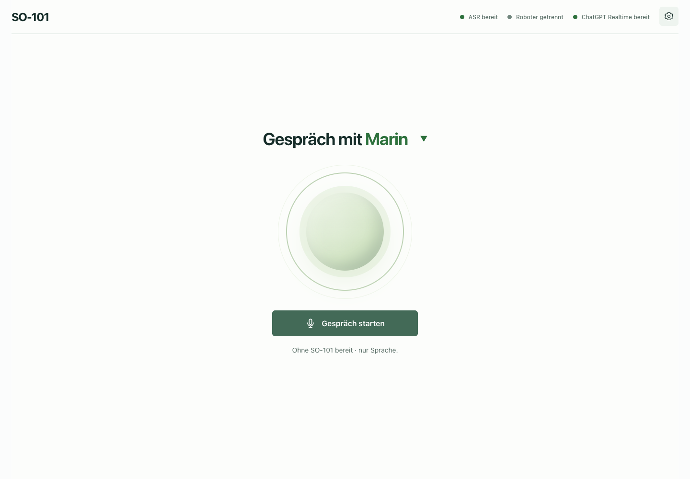
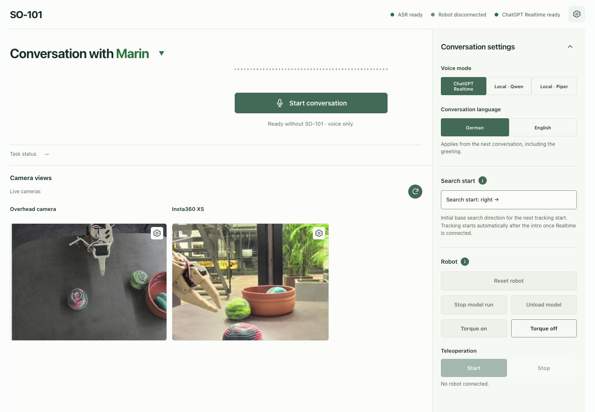

# SO101 RoboTalk — conversation with an SO-101 robot

RoboTalk is an experimental browser interface for spoken conversation with an
SO-101 robot. The conversation workspace is the homepage, with no tab selector.
It combines OpenAI Realtime or local speech, camera previews, face tracking,
teleoperation, and optional MolmoAct2 robot tasks. The interface is in English;
the spoken conversation language can be set separately to German or English.

## Demo video

Full SO-101 demonstration, including pick-and-place: **2:14**.

### Play demo

Play directly in your browser (**720p, 9.7 MB**):

https://github.com/user-attachments/assets/19da021a-d9f2-432e-9729-7bec39585895

[Download the 1080p MP4 (26.8 MB)](https://github.com/BlackChila/SO101-robotalk/raw/refs/heads/main/assets/demo/SO101-robotalk.mp4).

## Project overview

This repository continues the conversation functionality of
[2026-PG-robotalk](https://github.com/BlackChila/2026-PG-robotalk). The separate
control workspace and FLUX.3/Galaxea G0.5 experiments are omitted.

The reference system is **Linux ARM64 with an NVIDIA GB10 GPU** (DGX Spark / a
compatible GB10 workstation). The checked-in Python locks and CUDA wheels target
that system. macOS, Windows, CPU-only execution of the full app, and Linux x86-64
have not been validated.

**Project status:** a research prototype built around one local robot setup.
Some software and supervised physical checks are recorded, and the maintainer
reports successful MolmoAct2 pick-and-place trials. General task reliability
and all current motion paths have not been established. A fresh clone
does not include models, Python environments, robot calibration, or the external
MolmoAct2 installation. See [known setup gaps](docs/configuration.md#known-setup-gaps).

## What you can do

| Feature | What it uses |
| --- | --- |
| Cloud conversation | OpenAI Realtime; optional scene snapshots, web search, and MolmoAct2 task tools |
| Local conversation with Qwen speech | Qwen3-ASR → LM Studio tool/vision API → Qwen3-TTS CustomVoice; shared Piper vision and robot tools |
| Local conversation with Piper speech | Qwen3-ASR → LM Studio → CPU Piper; optional vision and robot tools |
| Project and creator information | On-demand lookups of [setup notes](docs/project-info.md) and [creator background](docs/creator-info.md) in all three conversation modes |
| Robot interaction | Camera controls, Leader/Follower teleoperation, saved-pose positioning, speech gripper animation, and face tracking |

**Current conversation status, reported by the maintainer:** OpenAI Realtime
and Local Piper are working on the reference setup. Piper provides a
**fully local workflow**: Qwen3-ASR transcribes speech, a locally hosted LM Studio
model generates replies and task calls, Piper speaks, and MolmoAct2 runs locally.
After downloading the required components, this mode needs no OpenAI key or
cloud conversation service. Use a local LM Studio endpoint for local processing.

Local Qwen now uses the same local conversation controller and tool/vision
protocol as Piper, with Qwen3-TTS CustomVoice speech. Hardware-free tests cover
the integration; live Qwen voice quality, concurrent runtime performance and
physical manipulation still need acceptance on the target setup. See the
[shared local conversation guide](docs/local-piper-conversation.md).

Conversation can run without an arm when the configured Follower serial device is
absent. With that device present, starting a conversation can position the arm,
play an intro gesture, and enable further movement. Realtime, Piper and Qwen can
dispatch explicitly requested robot tasks; they are not voice-only modes on a
connected robot.

## What to download

Download only the components for the workflow you want. **Model weights are not
in Git.** Installation commands and upstream download links are in
[the Linux setup guide](docs/getting-started.md).

| Component | Needed for | Download size / location |
| --- | --- | --- |
| Qwen3-ASR-1.7B | Local transcription and the app's ASR startup | ~4.70 GB → `models/asr/qwen3-asr-1.7b/` |
| Shared robot/camera runtime | Cameras, torque, intro, tracking and teleoperation | `environments/robot/`; no FLUX policy weights |
| MolmoAct2 converted and original checkpoints | Molmo inference and conversational manipulation | Reference installation uses ~44 GB; external setup required → `models/molmoact2/{runtime,source}` |
| Qwen3-TTS CustomVoice | Local Qwen speech | ~4.52 GB → `models/tts/qwen3-tts-1.7b-customvoice/` |
| Dialogue model in LM Studio | Both local conversation modes | Reference model: Qwen3.8-27B `Q4_K_M`; installed separately |
| Piper voice files | Local Piper speech | `.onnx` and `.onnx.json` pairs → `models/tts/piper/` |
| OpenCV YuNet | Face tracking | 232,589 bytes → `models/face-tracking/` |

Sizes above come from the committed manifests or installation notes, exclude
dependencies and caches, and are not total disk or GPU-memory requirements.
Each model and voice has its own upstream license. MolmoAct2 is optional for
voice conversation; its runtime is required for manipulation tasks.

## Hardware for local MolmoAct2 inference

These figures apply to the **SO-100/101 policy**, not training or the larger
DROID model. Ai2 publishes measurements for this checkpoint, but no guaranteed
minimum hardware specification. The official [SO-100/101 model card](https://huggingface.co/allenai/MolmoAct2-SO100_101#continuous-actions)
reports the following GPU-memory use:

| Inference mode | Official measurement | Meaning for this app |
| --- | --- | --- |
| BF16 (`bfloat16`) | Below **16 GB** in Ai2's tests | A **16 GB NVIDIA GPU with BF16 support** is a starting target for policy-only experiments, not a validated minimum for RoboTalk. It requires changing the local runtime configuration. |
| FP32, CUDA graphs off | About **24 GB** | Corresponds to the converted checkpoint's default precision and this app's live worker, which disables CUDA graphs. Allow extra free GPU memory for other processes. |
| FP32, CUDA graphs on | About **26 GB** | Upstream comparison; CUDA graphs are disabled in this app's live worker. |

**Good hardware target:** for the policy alone, plan for an NVIDIA GPU with
**32 GB VRAM or more** to give the FP32 path some headroom. For a workstation
with a discrete GPU, **64 GB system RAM** and **at least 150 GB free SSD space**
are practical planning allowances for loading models, environments and caches.
These are project recommendations, not upstream requirements or benchmarked
minimums. Ai2 does not specify a minimum CPU or system-RAM capacity. The two
checkpoint trees used here already occupy about **44 GB on disk**, before
dependencies, caches, speech models and the dialogue model.

The **complete local conversation stack needs additional memory** for ASR,
the LM Studio dialogue model, and optional Qwen TTS. A GPU that fits MolmoAct2
alone may not fit these concurrently; there is no combined memory or latency
benchmark for this app. A smaller dialogue model, or hosting LM Studio on
another machine, can reduce the local memory budget.

The project's reference system is **Linux ARM64 with NVIDIA GB10 / DGX Spark**.
DGX Spark has [128 GB of shared CPU/GPU unified memory](https://docs.nvidia.com/dgx/dgx-spark/hardware.html),
which is not 128 GB of dedicated VRAM. This adapter requires CUDA. Its MolmoAct2
environment is external and has no checked-in dependency lock; other platforms
remain unvalidated here.

For the lower-memory BF16 route, the [converted checkpoint configuration](https://huggingface.co/lerobot/MolmoAct2-SO100_101-LeRobot/blob/a93b5fcdce4c1e3cc7688c939fc943bf4b092a8a/config.json)
defaults to `model_dtype: "float32"`. Upstream [LeRobot's configuration](https://github.com/huggingface/lerobot/blob/v0.6.1/src/lerobot/policies/molmoact2/configuration_molmoact2.py)
supports `"bfloat16"`; selecting it in the local
`models/molmoact2/runtime/config.json` changes the precision. This path has not
been validated in RoboTalk. See the [MolmoAct2 adapter setup](environments/molmoact2/README.md)
for the external environment and checkpoint requirements. Sources checked on
2026-10-21.

## Conversational robot tasks

Explicitly requested manipulation uses
[MolmoAct2 SO100_101](https://huggingface.co/allenai/MolmoAct2-SO100_101) through
its [LeRobot conversion](https://huggingface.co/lerobot/MolmoAct2-SO100_101-LeRobot).
The maintainer reports successful pick-and-place on the reference setup without
project-specific fine-tuning. This is an observed result, not a benchmark or a
guarantee for another robot, scene or task. The dialogue model chooses a tool;
the separate policy and motor controller produce and execute gated joint actions.

## Function calls and robot features

The conversation model can request the following tools. The application validates
each call and handles camera access, information lookup or robot execution.

| Function call | What it does | Conversation modes |
| --- | --- | --- |
| `execute_molmo_task` | Sends one short movement instruction to MolmoAct2, such as a pick-and-place request. A new instruction replaces the running one. | Realtime, Local Piper, Local Qwen |
| `reset_robot` | Stops the task and returns to the recorded intro **end pose**, keeping the conversation and loaded model active. | All three |
| `look_at_scene` | Reads fresh Overhead and Wrist snapshots to describe the surroundings; does not move the arm. | All three |
| `get_project_info` | Retrieves reference information about the project, hardware, software and selected conversation setup. | All three |
| `get_creator_info` | Retrieves the project's recorded creator background and attribution. | All three |
| `search_web` | Looks up current information on the internet and returns a sourced answer. | Realtime only |

Movement tools require an active, configured robot session; manipulation also
requires the optional MolmoAct2 installation. The app announces requested motor
actions before execution. Neither local mode exposes web search. A stopped run
or a model reply does not establish that a physical task succeeded.

Other features use the conversation lifecycle or explicit UI controls:

- **Automatic interaction:** recorded intro gestures, gripper animation driven
  by speech loudness, and face tracking/search/head-tilt behavior when configured.
  Tracking yields to manipulation tasks.
- **Camera settings:** live previews, brightness/exposure controls and Insta360
  projection/zoom adjustment.
- **Operator controls:** stop a model run, unload the model, reset the robot,
  switch motor torque on/off, and start/stop Leader/Follower teleoperation.
  Ending a conversation requests a return toward the intro **start pose**;
  the return can be stopped into a measured hold.

See [speech modes and tool behavior](docs/speech-interface.md) and
[UI controls](ui/README.md) for prerequisites and lifecycle details.

## Interface

The interface is in English. Click the **gear icon in the top-right corner** to
open **Conversation settings**, with voice, language, tracking and robot controls.
The camera previews appear alongside the settings. Each camera's own gear opens
its camera controls. Click the top-right gear again or the panel's upward chevron
to close the settings and return to the focused conversation view.

**Conversation view — settings closed:**



**Settings open — overhead camera and Insta360 X5 side view:**



These illustrative previews use the actual app layout and archived camera stills
edited to remove the loose cable; they are not live hardware captures.
See [screenshot notes](assets/screenshots/README.md).

## Getting started on the reference Linux system

1. Install Git, Bash, Python 3.12, Node.js/npm, `uv`, and the Linux audio/video
   utilities listed in [prerequisites](docs/getting-started.md#prerequisites).
   Verify the NVIDIA driver and CUDA availability on the target host.
2. Clone the repository and follow [installation](docs/getting-started.md#clone-the-repository)
   to create the isolated ASR environment and download its checkpoint.
3. Add only the optional environments/models you need. Read
   [configuration](docs/configuration.md) before connecting robot hardware.
4. Build the UI and start the backend from the repository root in **Bash**:

```bash
npm --prefix ui ci
npm --prefix ui run build
source scripts/asr-env.sh
python -u scripts/asr_web.py
```

Open [http://127.0.0.1:8765/](http://127.0.0.1:8765/) on the same Linux host.
Allow microphone access. ASR warms in the background; the UI reports its readiness.
Keep the terminal open while using the app. For later starts, the activation and
backend commands are sufficient unless the UI or its dependencies changed.

`scripts/asr-env.sh` activates `environments/asr/.venv/bin/activate` and sets
the runtime's cache and offline-loading environment variables.

These commands assume installation is complete; they do not download weights.
The app binds to loopback by default. Do not expose the robot backend as a public
web service. Cloud conversation needs a separately configured OpenAI API key and
incurs API costs; local modes do not require that key.

## Optional local TTS setup

Both local conversation modes use **Qwen3-ASR → LM Studio → TTS**. Complete
[ASR installation](docs/getting-started.md#install-the-asr-backend) first, then choose
**one** speech engine below. Piper synthesizes on the CPU; Qwen3-TTS uses CUDA.
Neither local mode needs an OpenAI API key. Commands below run from the repository
root on the reference Linux ARM64 system.

### 1. Configure local dialogue

Install LM Studio, download/load a dialogue model and enable its API server.
Export the actual server URL and model key in the terminal that will start
RoboTalk; for example, when LM Studio listens on localhost:

```bash
export SO101_LM_STUDIO_URL=http://127.0.0.1:1234
export SO101_CONVERSATION_MODEL=qwen/qwen3.8-27b
```

These settings are process environment variables; putting them in `.env` does
not configure them. Export `SO101_LM_STUDIO_TOKEN` too if your server requires
authentication. The selected model must support tool calls and, for scene
descriptions, image input. See [LM Studio setup](environments/conversation/README.md).
The legacy Python environment in `environments/conversation/` is not required.

### 2a. Piper: CPU speech

```bash
UV_CACHE_DIR="$PWD/.cache/uv" uv sync --project environments/piper --frozen --python /usr/bin/python3.12
environments/piper/.venv/bin/python -m piper.download_voices \
  --download-dir models/tts/piper \
  de_DE-thorsten-medium de_DE-kerstin-low \
  en_US-amy-medium en_US-ryan-medium \
  en_GB-alan-medium en_GB-jenny_dioco-medium
environments/piper/.venv/bin/python scripts/piper_tts_worker.py \
  --sample /tmp/robotalk-piper-sample.wav
```

Each voice needs both its `.onnx` and `.onnx.json` files. The sample uses German
Thorsten and writes a WAV without playing audio or controlling the robot.
See [Piper installation and voice sources](environments/piper/README.md).
You do not need the Qwen3-TTS environment or weights for Piper.

### 2b. Qwen3-TTS: CUDA speech

```bash
UV_CACHE_DIR="$PWD/.cache/uv" uv sync --project environments/tts --frozen --python /usr/bin/python3.12
HF_HUB_OFFLINE=0 TRANSFORMERS_OFFLINE=0 HF_HUB_DISABLE_TELEMETRY=1 \
  HF_XET_CACHE="$PWD/.cache/hf-xet" \
  environments/tts/.venv/bin/python scripts/download_tts.py
environments/tts/.venv/bin/python scripts/tts_worker.py \
  --sample /tmp/robotalk-qwen-sample.wav
```

This downloads approximately 4.52 GB of CustomVoice weights into
`models/tts/qwen3-tts-1.7b-customvoice/`. The sample writes a German WAV using
Ryan; the UI supports German and English with nine speaker choices.
See [Qwen3-TTS installation](environments/tts/README.md). You do not need Piper
for this mode. Live Qwen speech and concurrent model performance still need
validation on the target host.

### 3. Start RoboTalk and select the mode

Build the UI if needed, then start the backend **in the terminal with the LM
Studio variables exported**:

```bash
source scripts/asr-env.sh
python -u scripts/asr_web.py
```

Open the app, use the settings gear and choose **Local · Piper**
or **Local · Qwen**. Set **Conversation language**
to **German** or **English** before starting a
call; Piper lists only voices for that language. Pick the voice from
the name in the conversation heading. The backend starts the selected TTS worker
automatically; a separate speech-worker terminal is not required.

For speech-only use with the configured arm absent, MolmoAct2 and the robot
runtime are not required. Camera and physical robot features need their separate
[optional setup](docs/getting-started.md#optional-shared-robot-and-camera-runtime).
See [local conversation behavior](docs/local-piper-conversation.md) and
[setup troubleshooting](docs/getting-started.md#troubleshooting).

## Before any robot movement

Read [scene setup](docs/scene-setup.md) and
[hardware configuration](docs/configuration.md#robot-and-camera-configuration).
The committed pose, calibration fingerprint, device paths, and intro trajectory
belong to the original robot. They are not calibration or a safe start pose for
another arm. New hardware needs its own calibrated and supervised setup.

- Starting the backend does not move the arm. Explicit positioning,
  torque, teleoperation, conversation, and task controls can do so.
- Inspect fresh cameras and commission your own intro/start-pose setup before
  starting a conversation with a connected arm. Settings expose robot reset,
  model unload, torque and teleoperation.
- **Stop model run** stops the current MolmoAct2 task while preserving the
  conversation and loaded model. There is no reliable automatic task-success
  detector; supervise and stop the run.
- Software stops and disconnects are intended to hold the measured pose with
  torque enabled. Verify the reported hold. Only an explicit torque-off action
  should release it; support the arm first. Unconfirmed communication is not a
  confirmed hold. Keep a physical power cutoff available.

Offline tests and finite model outputs do not establish safe motion, collision
avoidance, or successful manipulation.

## Documentation

- [Linux installation and downloads](docs/getting-started.md)
- [Configuration, privacy, and setup gaps](docs/configuration.md)
- [UI controls and development](ui/README.md)
- [Speech modes and their current behavior](docs/speech-interface.md)
- [Camera and scene setup](docs/scene-setup.md)
- [Local robot conversation](docs/local-piper-conversation.md)
- [Face tracking](docs/face-tracking.md) and [intro recording/replay](docs/demo-intro.md)
- [Environment overview](environments/README.md)
- [Documentation index](docs/README.md)

## Repository layout

```text
assets/demo/     Recorded intro audio and gesture bundles
config/          Reference robot start pose; ignored local camera settings
docs/            Conversation setup, behavior, and configuration guides
environments/    Independent Python projects, locks, and model manifests
scripts/         API server, speech/model workers, cameras, and robot controllers
tests/           Python software checks
ui/              Vite frontend and JavaScript tests
```

`models/`, `.cache/`, `outputs/`, `.venv` directories, and frontend build output
are local and ignored. Generated traces and images are not distributed in this repository.

## Contributing and licensing

See [CONTRIBUTING.md](CONTRIBUTING.md) for issue reports and validation expectations.
Please describe which Linux host, environment, checkpoint, and hardware you used;
keep software checks separate from physical results.

Original project code and documentation are licensed under
[Apache License 2.0](https://www.apache.org/licenses/LICENSE-2.0).
See [LICENSE](LICENSE) for the full terms and [NOTICE](NOTICE) for author and
project attribution. The license permits commercial use, modification, and
redistribution of this original material. When distributing it or derivatives,
retain the applicable license/attribution notices and mark modified files as
required by the license.

Suggested credit: **RoboTalk by BlackChila**, with a link to
[this repository](https://github.com/BlackChila/SO101-robotalk) and the license.

This license covers original contributions whose owners authorize these terms.
Third-party code, dependencies, model weights, and voices retain their own terms.
Bundled material in `assets/demo/` is excluded from this license
pending ownership and redistribution review; inclusion in Git grants no reuse
permission for those assets. See the [third-party inventory](docs/third-party-materials.md).
Apache-2.0 is compatible with Piper's GPLv3 licensing, but does not replace it:
a distributed combined worker/Piper program must also comply with GPL.
Model and voice restrictions still apply independently, including any upstream
noncommercial terms. See [the publication review](docs/publication-review.md#ownership-and-project-license).
The maintainer's
[publication checklist](docs/publishing-checklist.md) tracks licensing, asset
permissions, privacy review, and remaining release checks.
